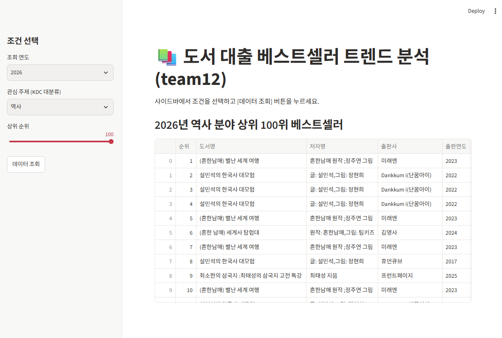

# 📚 도서 대출 베스트도서 트렌드 분석 (team12)

## 프로젝트 소개
도서관 정보나루 ISBN 서지정보 API를 활용하여 연도별, 주제별 대출 베스트도서 트렌드와 도서관 이용자들의 관심사 변화를 분석하는 Streamlit 웹 앱입니다.

## 팀원 정보 (고고한문)
* 김민혁 (202604169): 데이터 분석 및 결과 정리 담당
* 조현규 (202603153): 자료 수집 및 정리 담당

## 실행 방법
1. 터미널에서 패키지를 설치합니다: `pip install -r requirements.txt`
2. 앱을 실행합니다: `streamlit run app.py`

## 사용 라이브러리
* streamlit
* requests
* pandas

## 앱 실행 화면
